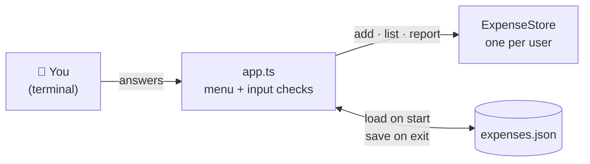
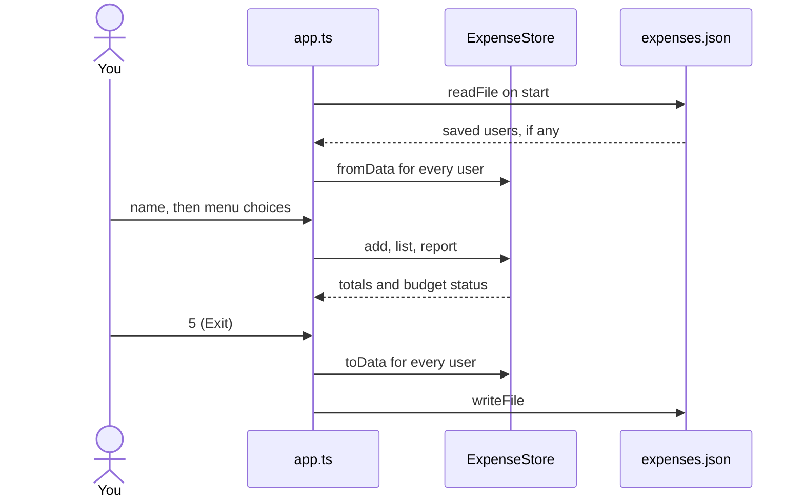

<div align="center">

# 💸 Kharcha

**A multi-user expense tracker for the terminal, written in TypeScript.**

Set a monthly budget, log your kharche, and get warned before you run out of money. Your data is saved between runs.


[Features](#-features) · [Quick start](#-quick-start) · [Demo](#-demo) · [How it works](#-how-it-works) · [Code tour](#-code-tour)

</div>

---

## ✨ Features

| | Feature | Details |
|---|---|---|
| 👥 | **Multiple users** | Every user has their own budget and expenses. Switch users any time from the menu. |
| ➕ | **Add expenses** | Amount, category, note and date. Category input is not case-sensitive (`FOOD` works). |
| 📋 | **List** | All expenses of the current user, shown as a table. |
| 📊 | **Report** | Budget status plus total spent per category. |
| ⚠️ | **Budget warning** | After every new expense you are warned at 80% of the budget, and again when you go over. Expenses are always recorded, never blocked. |
| 🔁 | **Input retries** | A wrong amount or category gets 3 tries. After that only that action is cancelled, the app keeps running. |
| 💾 | **Save and load** | Everything is written to `expenses.json` when you exit and loaded back on the next start, with the same expense ids. |

---

## 🚀 Quick start

**You need:** Node.js 18 or newer (`node -v` to check).

```bash
git clone https://github.com/himanshuvarshney001/kharcha-expense-tracker.git
cd kharcha-expense-tracker
npm install
npm run app
```

> **Important:** always leave the app with option **`5. Exit`**. That is when your data is saved. Closing with `Ctrl + C` loses the changes of that session.

<details>
<summary><b>All npm scripts</b></summary>

| Command | What it does |
|---|---|
| `npm run app` | Compile and start the interactive app (`src/app.ts`) |
| `npm run dev` | Compile and run the scripted demo (`src/index.ts`) |
| `npm run build` | Type-check and compile `src/` into `dist/` |
| `npm start` | Run the compiled demo without compiling again |
| `npm run watch` | Recompile on every save |

</details>

---

## 🎬 Demo

```text
$ npm run app
Enter user name? himanshu
Enter budget in integer?5000

0. Switch user
1. Kharcha add karo
2. List dekho
3. Report
4. Show current user
5. Exit
Choose karo: 1
Category (food/travel/rent/shopping/other)? fod
"fod" koi category nahi hai. 2 try bache
Category (food/travel/rent/shopping/other)? food
Enter amount in integer?abc
Galat number. 2 try bache
Enter amount in integer?4200
note? Mess fees
date? 2026-11-10
Dhayan do bas sirf itna bacha hai budget ₹800
```

<details>
<summary><b>See the list and report screens</b></summary>

```text
Choose karo: 2
┌─────────┬────┬────────┬──────────┬─────────────┬──────────────┐
│ (index) │ id │ amount │ category │ note        │ date         │
├─────────┼────┼────────┼──────────┼─────────────┼──────────────┤
│ 0       │ 1  │ 4200   │ 'food'   │ 'Mess fees' │ '2026-11-10' │
└─────────┴────┴────────┴──────────┴─────────────┴──────────────┘

Choose karo: 3
Dhayan do bas sirf itna bacha hai budget ₹800
{ food: 4200 }
```

</details>

<details>
<summary><b>Coming back the next day</b></summary>

```text
$ npm run app
Enter user name? himanshu
Welcome back
```

No budget question this time: `himanshu` and all his expenses were loaded from `expenses.json`. A new expense continues from the last id, so ids never repeat.

</details>

---

## ⚙️ How it works

The app is split into layers. `ExpenseStore` only knows about expenses and money. It has no idea whether the input came from a terminal, a web page or a file.



### Budget status

| Spent (budget ₹5000) | Status | Message |
|---|---|---|
| Less than 80%, e.g. ₹1900 | `ok` | `sab theek hai budget ₹3100 maje lo` |
| 80% or more, e.g. ₹4200 | `warning` | `Dhayan do bas sirf itna bacha hai budget ₹800` |
| More than the budget, e.g. ₹5600 | `over` | `Budget se budget ₹600 zyaada!` |

### One session, start to finish



<details>
<summary><b>What <code>expenses.json</code> looks like</b></summary>

The user name is the key. The file is listed in `.gitignore`, so your personal data never goes to GitHub.

```json
{
  "himanshu": {
    "budget": 5000,
    "expences": [
      {
        "id": 1,
        "amount": 4200,
        "category": "food",
        "note": "Mess fees",
        "date": "2026-11-10"
      }
    ]
  }
}
```

</details>

---

## 🗺️ Code tour

<details>
<summary><b>Project structure</b></summary>

```text
src/
├── app.ts           # interactive app: menu, input retries, save and load
├── expenseStore.ts  # ExpenseStore class, one per user
├── type.ts          # types, CATEGORIES and the isCategory type guard
└── index.ts         # scripted demo used by npm run dev
```

`dist/` holds the compiled JavaScript and is generated by `tsc`.

</details>

<details>
<summary><b>Data model (<code>type.ts</code>)</b></summary>

```ts
export const CATEGORIES = ["food", "travel", "rent", "shopping", "other"] as const;
export type Category = (typeof CATEGORIES)[number];

export type Expense = {
  readonly id: number;
  amount: number;
  category: Category;
  note: string;
  date: string;
};

export type newExpences = Omit<Expense, "id">;          // the store assigns the id
export type StoreData = { budget: number; expences: Expense[] };
export type saveFile = Record<string, StoreData>;      // user name → their data
```

The category list is written once, as a real array. The `Category` type is derived from it, and `isCategory()` checks user input against the same array.

</details>

<details>
<summary><b><code>ExpenseStore</code> API</b></summary>

| Method | Returns | What it does |
|---|---|---|
| `add(data)` | `Expense \| undefined` | Adds an expense and gives it the next id. Throws if the amount is 0 or less |
| `list()` | `readonly Expense[]` | All expenses (read-only) |
| `totalSpent()` | `number` | Sum of all amounts |
| `remaining()` | `number` | Budget minus total spent |
| `update(id, changes)` | `Expense \| undefined` | Changes some fields of one expense |
| `remove(id)` | `boolean` | Deletes one expense |
| `checkBudget()` | `"ok" \| "warning" \| "over"` | Budget status as a label |
| `describe()` | `string` | Budget status as a message |
| `totalByCategory()` | `{ food?: number, ... }` | Total per category, only categories with spending |
| `toData()` | `StoreData` | Plain data for saving |
| `ExpenseStore.fromData(data)` | `ExpenseStore` | Rebuilds a store from saved data, continuing from the highest id |

</details>

<details>
<summary><b>TypeScript concepts used</b></summary>

| Concept | Where |
|---|---|
| Literal union derived from an array (`as const`, `typeof X[number]`) | `Category` |
| Type guard (`s is Category`) | `isCategory()` |
| `Omit`, `Partial`, `Record` | `newExpences`, `update()`, `totalByCategory()`, `saveFile` |
| Classes with `private`, `readonly` and `static` | `ExpenseStore`, `fromData()` |
| Read-only arrays and copies (`[...array]`) | `list()`, `toData()` |
| Literal union as a return type | `checkBudget()` |
| `Map<string, ExpenseStore>` | Users in `app.ts` |
| `async`/`await` with `readline/promises` and `fs/promises` | Input, save and load |
| Default parameters and `T \| undefined` returns | `askNumber()`, `askCategory()` |

</details>

---

## 🚧 Known limitations

- Data is saved only through **`5. Exit`**, not after every change.
- `expenses.json` is trusted when it is loaded. A hand-edited or half-written file can break the app.
- `update` and `remove` exist in `ExpenseStore` but are not in the menu yet.
- Dates are free text. Use `YYYY-MM-DD` to keep them consistent.
- User names are case-sensitive: `Himanshu` and `himanshu` are two different users.

---

<div align="center">

Built while learning TypeScript · [Report an issue](https://github.com/himanshuvarshney001/kharcha-expense-tracker/issues)

</div>
